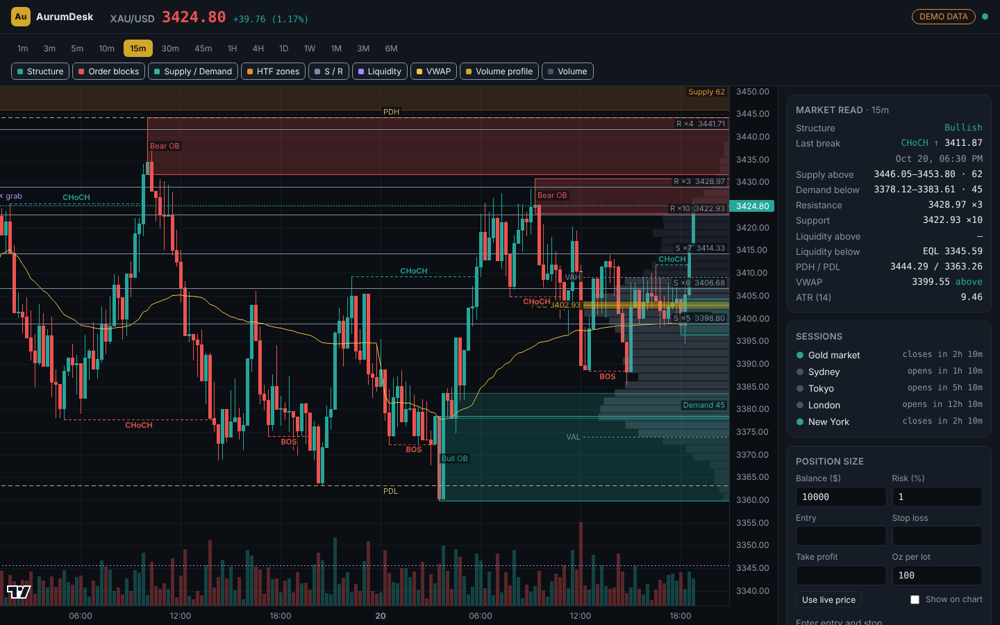

# AurumDesk: XAU/USD gold terminal



A self-hosted, full-screen gold chart with automatic price-action analysis:
market structure (BOS/CHoCH), order blocks, scored supply and demand zones,
higher-timeframe zones, support and resistance, liquidity pools and sweeps,
previous-day high/low, VWAP and a volume profile. Fourteen timeframes, from 1m to 6M.

All analysis runs on **closed candles only**, so a zone or break never appears
and then disappears while a candle is still forming.

## Put it online

[](https://render.com/deploy?repo=https://github.com/JaveedFiaz/aurumdesk)

Click the button, sign in to Render (free), and press **Apply**. After a few minutes
you get a public link like `https://aurumdesk.onrender.com`. On the free plan the
site sleeps after 15 minutes without visitors and takes about a minute to wake.

## Run it on your computer

Requires Node.js 20.12 or newer.

```bash
npm install
cp .env.example .env      # pick a data provider (default: Binance PAXG, no key)
npm start                 # http://localhost:3000
```

Run `npm run demo` to try it offline with synthetic prices, and `npm test` to run the test suite.
`npm run build:hosted` builds `dist/aurumdesk.html`, a single static page that runs on demo prices with no server.

## Data providers

Set `PROVIDER` in `.env`:

| Provider | What you get | Key |
|---|---|---|
| `binance` (default) | PAXG/USDT from Binance's public market-data API. PAXG is a token backed by physical gold and tracks spot closely. It trades 24/7, so weekend candles appear. | None |
| `twelvedata` | Real spot XAU/USD. The free plan (8 req/min, 800/day) is too small for live use; use a paid plan or raise `POLL_MS`. | `TWELVEDATA_API_KEY` |
| `demo` | Synthetic prices for testing. Not market data. | None |

Timeframes a provider doesn't offer natively (10m, 45m, 3M, 6M…) are built by
the server from smaller candles. To add your broker's feed, copy
`server/providers/twelvedata.js`: a provider only needs `natives`,
`fetchCandles(interval, limit)` and `fetchPrice()`.

## What the tools do

| Tool | Method |
|---|---|
| **Structure** | 5-bar fractal swings. A close beyond the latest swing high/low is a **BOS** with the trend, or a **CHoCH** against it. |
| **Order blocks** | For each break, the last opposite-colour candle at the extreme of the leg. Removed once a candle closes through it. |
| **Supply / Demand** | 1–3 small "base" candles followed by an impulse candle with a body ≥ 1.6× ATR. Score 0–100 = impulse strength (40) + freshness (30, falls with each revisit) + tight base (15) + formed with the trend (15). |
| **HTF zones** (dashed) | Supply/demand from a higher timeframe (e.g. 4H on a 15m chart), projected down. |
| **S / R** | Swing points within 0.35× ATR clustered together; at least 2 touches. |
| **Liquidity** | Equal highs/lows (EQH/EQL) where stops cluster. "✕ grab" marks a wick through a pool that closed back inside. PDH/PDL on intraday charts. |
| **VWAP** | Anchored daily below 4H, weekly on 4H, monthly on 1D. |
| **Volume profile** | Volume by price over the visible candles, with POC and the 70% value area (VAH/VAL). |

The side panel has a market summary, session clocks (DST-aware), a position-size
calculator (100 oz per lot by default) that can draw entry/SL/TP on the chart,
and in-page/browser alerts for new breaks, liquidity grabs and price entering zones scored 60+.

## Project layout

```
server/index.js          HTTP server: static files, /api/candles, /api/stream (SSE ticks)
server/providers/        binance, twelvedata, demo
shared/timeframes.js     timeframe definitions, bucketing, aggregation
shared/analysis.js       the analysis engine (pure functions, used in the browser)
public/                  UI: app.js, overlay.js (canvas drawings), sessions.js, calculator.js
test/                    node:test suite
```

The chart is [TradingView Lightweight Charts](https://github.com/tradingview/lightweight-charts) (Apache 2.0, attribution logo kept).

## Disclaimer

Educational charting tool. It is not financial advice and does not give buy or
sell signals. Prices are indicative and may differ from your broker.
